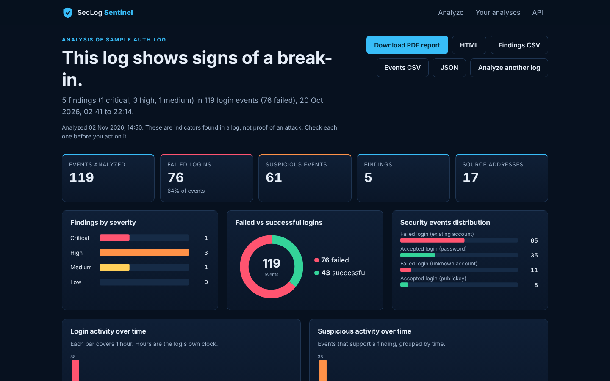
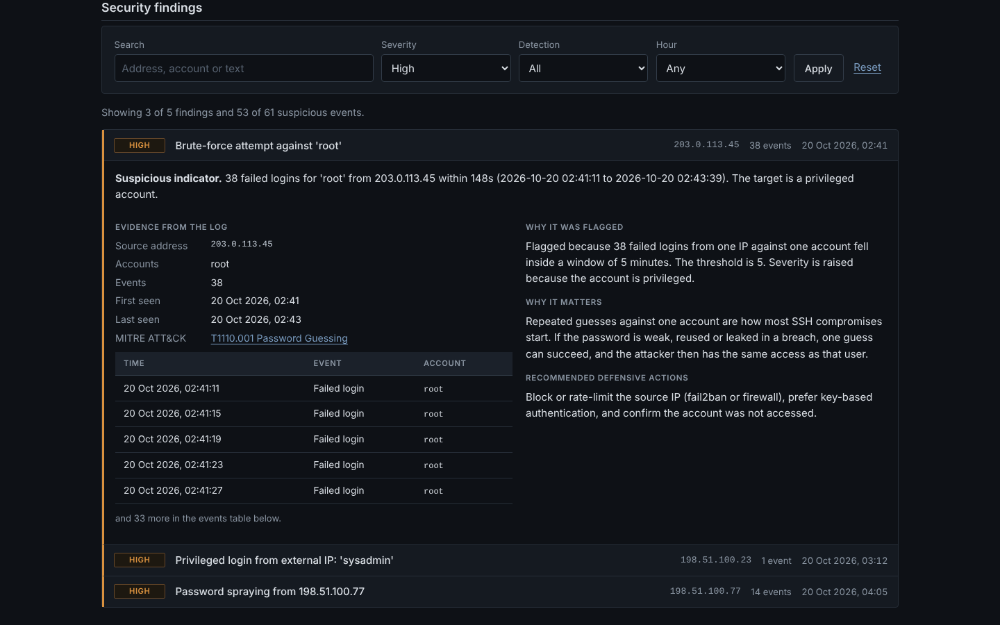
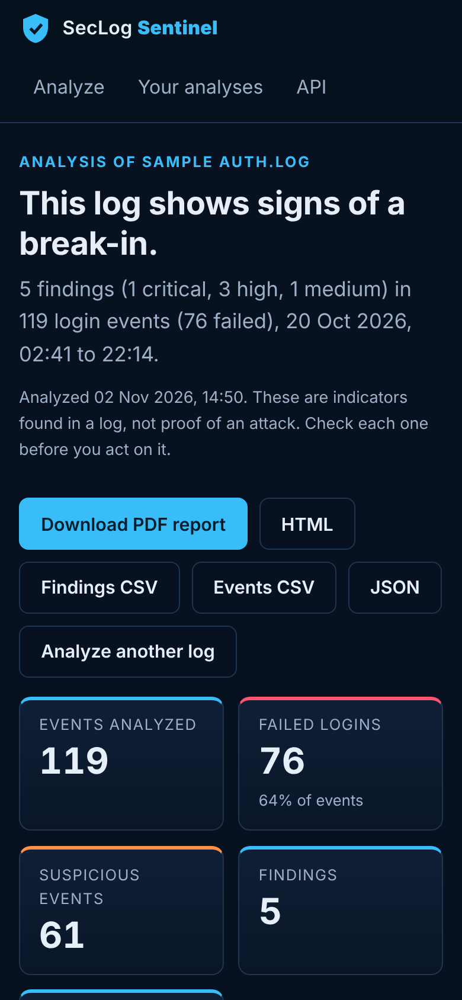
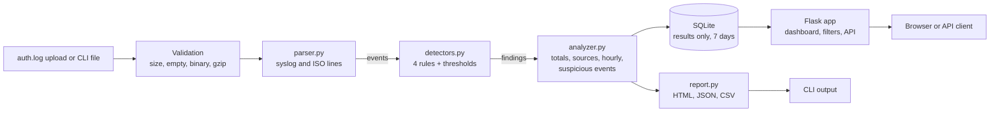

# SecLog Sentinel

[](https://github.com/ghaadii99aa-create/seclog-sentinel/actions/workflows/ci.yml)


**Live demo: [seclog-sentinel.onrender.com](https://seclog-sentinel.onrender.com)** (try the sample log, no sign-up).
It runs on a free Render instance that sleeps when idle, so the first visit can take about a minute.

A web app, REST API and command-line tool that read SSH authentication logs, find signs of
credential attacks, explain *why* each one was flagged, and say what to check next. Findings are
mapped to **MITRE ATT&CK**.



## The problem

Any Linux server with SSH open to the internet collects thousands of failed logins a day in
`/var/log/auth.log`. Buried in that noise is the line that matters: a password guess that finally
worked. Small IT teams rarely have a SIEM, so the log goes unread.

SecLog Sentinel turns that file into a short list of findings with severity, evidence, and a
recommended action. It is deliberately honest about what a log can prove: every finding is an
**indicator**, labelled either *Suspicious indicator* or *Likely compromise, investigate now*, and
nothing is ever called a confirmed attack.

## Features

| | |
|---|---|
| **Dashboard** | Events analyzed, failed logins, suspicious events, findings, severity distribution, recent suspicious activity, hourly chart. Responsive on phone and desktop |
| **Detections** | Brute force, password spraying, likely account takeover (a success after repeated failures), privileged login from outside the internal network. All thresholds and time windows are configurable |
| **Explainable** | Each finding shows the evidence, the rule that fired, the threshold it crossed, and a recommended action |
| **Filter and search** | Filter findings and events by severity, detection, hour of day, and free text. Click a bar in a chart to filter. Works without JavaScript; JavaScript adds instant search |
| **Reports** | Self-contained HTML report, JSON, and two CSV files (findings, suspicious events) |
| **Log formats** | Classic syslog timestamps (Debian, Ubuntu before 22.04, RHEL `/var/log/secure`, `journalctl`) and ISO 8601 timestamps (Ubuntu 22.04+, Debian 12) |
| **Validation** | Rejects empty, binary, gzip and oversized files with a message that says how to fix it; ignores malformed lines instead of failing |
| **REST API** | Same engine over HTTP, JSON errors everywhere. See [docs/API.md](docs/API.md) |
| **CLI** | Dependency-free, with exit codes for CI use (`--fail-on high`) |



<details>
<summary>Mobile view</summary>



</details>

## What it detects

| Detection | What it looks for | Severity | MITRE ATT&CK |
|---|---|---|---|
| **Brute force** | Many failed logins from one IP against one account in a short window | Medium / High | [T1110.001](https://attack.mitre.org/techniques/T1110/001/) |
| **Password spraying** | One IP failing against many accounts. Critical if that IP later logs in successfully | Medium / High / Critical | [T1110.003](https://attack.mitre.org/techniques/T1110/003/) |
| **Likely account takeover** | A successful login right after repeated failures for the same IP and account | Critical | [T1078](https://attack.mitre.org/techniques/T1078/) |
| **Privileged login from outside** | `root`, `admin` and similar signing in from outside the internal network ranges | High | [T1078](https://attack.mitre.org/techniques/T1078/) |

A "likely takeover" can also be a user who mistyped their password a few times. The explanation on
each finding says so and tells the reader to verify.

## Architecture



The raw log lives only in memory during the request. The parser, detectors and analyzer have no web
dependency, so the same code serves the CLI, the API and the dashboard.

## Technology

| Technology | Used for | Why this choice |
|---|---|---|
| **Python 3.9+** | Parser, detection rules, CLI | The core uses only the standard library, so the CLI installs nowhere and runs anywhere |
| **Flask 3** | Web pages and REST API | Small, explicit and easy to read. Server-rendered Jinja templates escape output by default |
| **SQLite** | Storing results for the share link and history | No server to run; fine for one instance. The limits are documented below |
| **gunicorn** | Production WSGI server | Standard for Flask; used on Render and in the Docker image |
| **Vanilla JavaScript** | Live search, drag-and-drop, copy button | Progressive enhancement only. Every page works with JavaScript off, and a strict CSP forbids inline scripts |
| **SVG** | Charts | No chart library, no inline styles; bars are plain attributes so the CSP can stay strict |
| **unittest** | Tests | Standard library, no extra dependencies |
| **ruff** | Linting | Fast, one config in `pyproject.toml` |
| **Docker** | Container image | Non-root user, health check, volume for results |
| **GitHub Actions** | CI | Lint, tests on Python 3.9 to 3.13, and a build and smoke test of the Docker image |
| **Render** | Hosting the live demo | Free web service, blueprint in `render.yaml` |
| **MITRE ATT&CK** | Naming each technique | Lets findings feed existing SOC workflows |

## Run it locally

```bash
git clone https://github.com/ghaadii99aa-create/seclog-sentinel.git
cd seclog-sentinel
python -m venv .venv && source .venv/bin/activate     # Windows: .venv\Scripts\activate
pip install -r requirements.txt
flask --app wsgi run                                   # http://127.0.0.1:5000
```

Open the page, drop in an `auth.log`, or click **Or try the sample log**.

### Command line

No dependencies needed:

```bash
python -m seclog sample_data/auth.log --year 2026 --html report.html --json report.json --csv findings.csv
python -m seclog /var/log/auth.log --fail-on high || echo "high severity findings"
python -m seclog --help
```

| Exit code | Meaning |
|---|---|
| `0` | Analysis finished, nothing at or above `--fail-on` |
| `1` | Input or configuration error (unreadable file, bad CIDR) |
| `2` | At least one finding at or above `--fail-on` |

### Docker

```bash
docker build -t seclog-sentinel .
docker run -p 8000:8000 -v seclog-data:/data seclog-sentinel
```

### Configuration

All settings are environment variables (see [`.env.example`](.env.example)).

| Variable | Default | Purpose |
|---|---|---|
| `SECLOG_DB` | `data/seclog.db` | SQLite file for results |
| `SECLOG_TRUST_PROXY` | unset | `1` behind a reverse proxy, to read client IPs and HTTPS from `X-Forwarded-*` |
| `SECLOG_EPHEMERAL` | unset | `1` on hosts that erase local files when idle. The UI then never promises to keep results |
| `SECLOG_REPO_URL` | unset | Adds a source link to the footer |
| `SECLOG_LOG_LEVEL` | `INFO` | `DEBUG`, `INFO`, `WARNING` or `ERROR` |

## API

```bash
# Analyze a log. Optional fields: year, brute_force_threshold, brute_force_window, spray_users,
# spray_window, compromise_failures, compromise_window, privileged, internal_networks
curl -F file=@sample_data/auth.log -F year=2026 https://seclog-sentinel.onrender.com/api/analyze

# Fetch a stored result
curl https://seclog-sentinel.onrender.com/api/analyses/<id>
```

`POST /api/analyze` returns `201` with the summary, findings, suspicious events and the page URL.
Errors are always JSON, `{"error": "..."}`, with `400`, `404`, `405`, `413`, `429` or `500`.
The API sends no CORS headers. Full request and response reference: **[docs/API.md](docs/API.md)**.

## Sample data and expected results

`sample_data/` holds three synthetic logs and `expected_results.json`, which says exactly what the
detectors must report for each file. For `auth.log`: 119 events, five findings (1 critical, 3 high,
1 medium) and 61 suspicious events. `clean.log` must produce none. See
[sample_data/README.md](sample_data/README.md). Attacker addresses use the RFC 5737 documentation
ranges, which never route on the internet.

## Tests

```bash
python -m unittest discover -s tests -t . -v
ruff check .
```

**Verified results** (run on 22 Oct 2026, Python 3.13 with Flask 3.1, commit of this branch):

| Suite | Tests | Result |
|---|---|---|
| Parser, edge cases and random-mutation test | 20 | pass |
| Detection rules and severity | 16 | pass |
| Sample logs against `expected_results.json` | 6 | pass |
| CLI and reports (HTML, JSON, CSV) | 14 | pass |
| Web: pages, upload validation, filters, CSV downloads, API, hardening, storage | 66 | pass |
| **Total** | **124** | **124 passed, 0 failed, 0 skipped** |

Without Flask installed the 66 web tests are skipped and the other 58 pass (checked on Python 3.11
and 3.12). `ruff check .` reports no problems. GitHub Actions runs lint, the test suite on Python
3.9 to 3.13 and a Docker build with a smoke test on every push to `main` and every pull request.

What the tests cover: log parsing (both timestamp formats, malformed, truncated, oversized and
hostile lines), every rule including the cases that must *not* alert, severity classification,
upload validation (empty, binary, gzip, too large, bad settings), the API schema and its error
responses, report contents (HTML, JSON and CSV compared with the analysis), filters, the health
check, the rate limiter, retention, and the security headers.

## Cloud deployment

The demo runs on **Render** (free web service, Python runtime) from `main`, configured by
[`render.yaml`](render.yaml): `pip install -r requirements.txt`, gunicorn, `/healthz` as the health
check, and environment variables for the proxy, the ephemeral-storage notice and the database path.
It is **not** deployed to AWS, Azure or Google Cloud. [docs/DEPLOYMENT.md](docs/DEPLOYMENT.md)
lists every Render setting and describes how the container image would map to other platforms.

## Security

Auth logs are attacker-controlled input and the app accepts uploads from the internet, so it is
built defensively: escaped output plus a strict Content Security Policy, spreadsheet-formula
protection in CSV, validated uploads and settings, path-safe file handling (the file name is never
used as a path), rate limiting, cross-site POST protection, security headers, generic error pages
with details only in the server log, and no secrets in the code. Each control has a test.

**What is stored:** the raw log is never stored. The findings, up to 1000 suspicious events
(time, account, address) and counts are kept for 7 days (less on the free host, which erases them
when it restarts). Anyone with a result link can read it, so use synthetic or non-sensitive logs.

The full review, with the test behind each control and the known gaps, is in
**[docs/SECURITY.md](docs/SECURITY.md)**. This is a portfolio project: it has not had an independent
penetration test and should not be described as production-grade.

## Limitations

- Parses OpenSSH `Failed` and `Accepted` messages only. Other daemons and other SSH log messages are ignored.
- Rule-based detection with fixed windows. No IP reputation, GeoIP or machine learning. It can
  miss slow or distributed attacks and can flag legitimate activity.
- ISO timestamps are read as wall-clock time; mixed time zones in one file are not normalised.
- The rate limiter is in memory per process and results sit in one SQLite file. Fine for a demo and a
  single instance; production would need Redis or Postgres.
- The free Render instance sleeps when idle, and saved analyses disappear on restart.
- The Dockerfile has not been built on the author's machine. A GitHub Actions job builds the image and smoke-tests the running container on every push, so the CI badge is the evidence that it works.

## Roadmap

- Windows Event Log (4624 / 4625) support
- GeoIP and reputation enrichment
- Alerts by email or Slack
- PostgreSQL storage and a shared rate limiter for multi-instance deployment
- Arabic interface

## Author

**Ghadi Alharthy**, Information Technology graduate specializing in Information Security.
[GitHub](https://github.com/ghaadii99aa-create)

## License

MIT. See [LICENSE](LICENSE).
