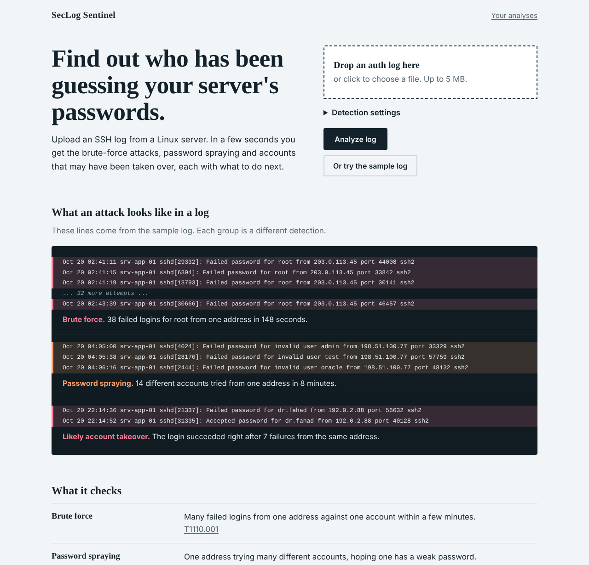
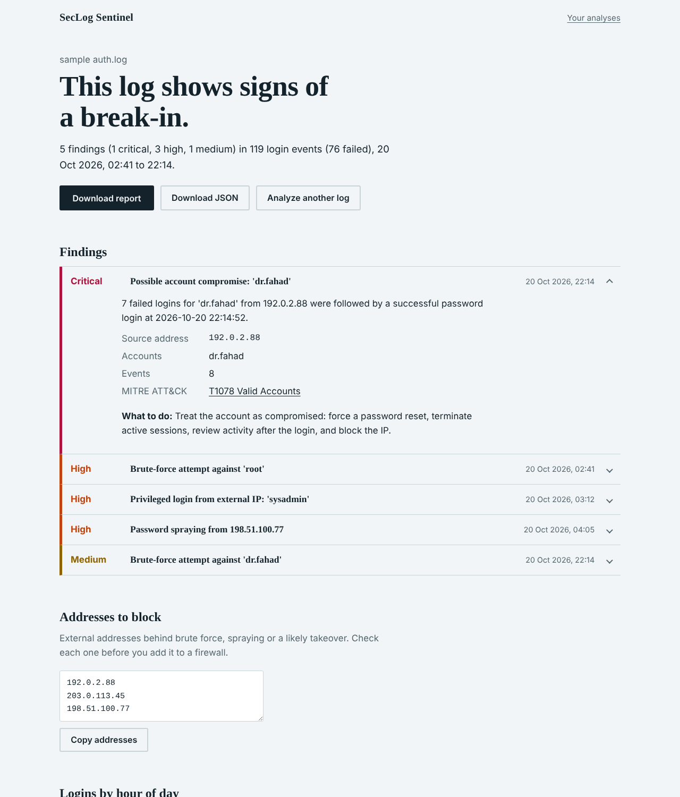

# SecLog Sentinel

[](https://github.com/ghaadii99aa-create/seclog-sentinel/actions/workflows/ci.yml)


**Live demo: [YOUR-APP.onrender.com](https://YOUR-APP.onrender.com)** (try the sample log, no sign-up)

A web app and command-line tool that reads SSH authentication logs, detects credential
attacks, and explains what to do next. Every finding is mapped to **MITRE ATT&CK**.

Built for small IT teams that need answers from `/var/log/auth.log` without standing up a SIEM.





## What it detects

| Detection | What it looks for | Severity | MITRE ATT&CK |
|---|---|---|---|
| **Brute force** | Many failed logins from one IP against one account in a short window | Medium / High | [T1110.001](https://attack.mitre.org/techniques/T1110/001/) |
| **Password spraying** | One IP trying many accounts. Critical if that IP later logs in successfully | Medium / High / Critical | [T1110.003](https://attack.mitre.org/techniques/T1110/003/) |
| **Likely account takeover** | A successful login right after repeated failures for the same IP and account | Critical | [T1078](https://attack.mitre.org/techniques/T1078/) |
| **Admin login from outside** | `root`, `admin` etc. signing in from outside the internal network ranges | High | [T1078](https://attack.mitre.org/techniques/T1078/) |

Thresholds, time windows, privileged account names and internal networks are all configurable,
from the web form, the API, or CLI flags.

## Run the web app

```bash
git clone https://github.com/ghaadii99aa-create/seclog-sentinel.git
cd seclog-sentinel
pip install -r requirements.txt

flask --app wsgi run          # development server on http://127.0.0.1:5000
```

Open the page, drop in an `auth.log`, or click **Or try the sample log**.

| Setting | Default | Purpose |
|---|---|---|
| `SECLOG_DB` | `data/seclog.db` | Path of the SQLite file that holds results |
| `SECLOG_TRUST_PROXY` | unset | Set to `1` behind a reverse proxy so client IPs and HTTPS are read from `X-Forwarded-*` |
| `SECLOG_REPO_URL` | unset | Adds a "View the source code" link to the footer |
| `SECLOG_EPHEMERAL` | unset | Set to `1` on hosts that erase local files when idle (free tiers). Changes the on-page wording so it never promises to keep results |

### Deploy

**Render (free, no Docker needed).** The repo includes a `render.yaml` blueprint.

1. Push the repo to GitHub.
2. On [Render](https://render.com), choose **New > Blueprint**, pick the repo and apply it.
   Render installs `requirements.txt`, starts the app with gunicorn and uses `/healthz` as the health check.
3. Open the `onrender.com` URL it gives you and put it at the top of this README.

Free Render services sleep after 15 minutes without traffic and take about a minute to wake up
on the next visit. Their local files are erased on every restart, so saved analyses are
short-lived there. The blueprint sets `SECLOG_EPHEMERAL=1` so the interface says so. Download
the report if you want to keep one. For persistent history, use a paid instance with a disk or
move storage to Postgres.

**Docker.** A `Dockerfile` (gunicorn, non-root user) is included for any host that runs containers:

```bash
docker build -t seclog-sentinel .
docker run -p 8000:8000 -v seclog-data:/data seclog-sentinel
```

## REST API

Interactive use is optional. Everything the page does is available over HTTP:

```bash
# Analyze a log (multipart upload). Optional fields: year, brute_force_threshold,
# brute_force_window, spray_users, spray_window, privileged, internal_networks
curl -F file=@/var/log/auth.log -F year=2026 https://YOUR-APP.onrender.com/api/analyze

# Fetch a stored result
curl https://YOUR-APP.onrender.com/api/analyses/<id>
```

`POST /api/analyze` returns `201` with the analysis, the shareable page URL and the API URL.
Errors are JSON: `{"error": "..."}` with `400`, `404`, `413` or `429`.

## Command line

The same engine works without the web app and has no dependencies:

```bash
python -m seclog sample_data/auth.log --year 2026 --html report.html --json report.json
python -m seclog /var/log/auth.log --fail-on high || notify-team.sh
```

| Exit code | Meaning |
|---|---|
| `0` | Analysis finished, nothing at or above `--fail-on` |
| `1` | Input or configuration error (unreadable file, bad CIDR) |
| `2` | At least one finding at or above `--fail-on` |

Run `python -m seclog --help` for every option.

## How it works

```text
auth.log -> parser.py -> events -> detectors.py -> findings -> analyzer.py -> result
                                                                   |
                          CLI: report.py (HTML / JSON)     Web: Flask + SQLite (results only)
```

- **`parser.py`** parses sshd lines, validates IPs, handles the missing year in syslog
  timestamps (including the December to January rollover) and neutralises control characters.
- **`detectors.py`** holds each rule as a small pure function. Brute force and spraying use a
  sliding window over time-sorted events, so cost stays linear in the number of events.
- **`analyzer.py`** adds totals, top sources and an hour-of-day histogram.
- **`web/`** is a Flask app with server-rendered pages, no JavaScript framework, and a small
  script that only enhances drag-and-drop. Every page works with JavaScript turned off.

## Security design

Auth logs are attacker-controlled input, and this app accepts uploads from the internet, so
it is built defensively. Each point below is covered by a test.

- **Output is escaped.** Usernames and file names are escaped by the template engine, and the
  control characters that could tamper with terminal output are stripped at parse time.
- **Strict Content Security Policy.** `script-src 'self'; style-src 'self'` with no
  `unsafe-inline`, so an injected script or style could not run even if escaping failed.
  The chart is drawn with SVG attributes for this reason.
- **Raw logs are never stored.** A file is analysed in memory and discarded. Only the findings
  and counts are saved, and they are deleted after 7 days.
- **Unguessable share links, private history.** Each result has a random ID. The history page
  and the delete action are tied to an `HttpOnly`, `SameSite=Lax` cookie.
- **Abuse limits.** 5 MB upload cap, validated settings with bounds, and a per-client rate limit.
- **Cross-site POST protection.** Form posts with a foreign `Origin` header are rejected.
- **Hardening headers.** `X-Content-Type-Options`, `X-Frame-Options`, `Referrer-Policy`,
  HSTS over HTTPS, and `Cache-Control: no-store` on dynamic pages.

## Tests

```bash
python -m unittest discover -s tests -t . -v
```

57 tests cover the parser, every detection rule (including the cases that must *not* alert),
report escaping, CLI exit codes, upload validation, ownership and sharing rules, the rate
limiter, the API, and data retention. GitHub Actions runs them on Python 3.9 to 3.13.

## Sample data

`sample_data/auth.log` is **fully synthetic**: a normal day of staff logins with occasional
typos, four injected attacks, and harmless noise that must not trigger alerts. Attacker
addresses come from the RFC 5737 documentation ranges, which never route on the real internet.

```bash
python scripts/generate_sample_data.py --out sample_data/auth.log --seed 42
```

## Limitations and roadmap

- Parses OpenSSH `Failed` and `Accepted` messages only.
- Rule-based detection with fixed windows. No IP reputation or GeoIP.
- The rate limiter is in memory per worker process, and SQLite is a single local file. Both are
  fine for a demo. A shared store such as Redis or Postgres would be the next step for production.
- Ideas: Windows Event Log (4624/4625) support, GeoIP enrichment, Arabic interface, and alerting
  by email or Slack.

## Author

**Ghadi Alharthy**, Information Technology graduate specializing in Information Security.

[LinkedIn](https://www.linkedin.com/in/YOUR-LINKEDIN-HANDLE)

## License

MIT. See [LICENSE](LICENSE).
